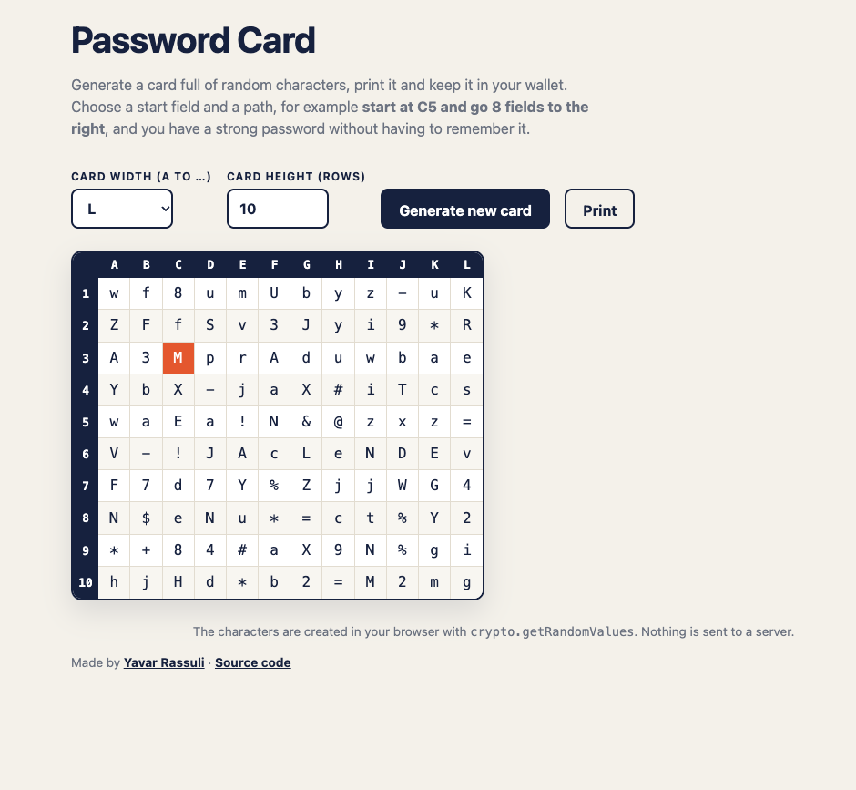

# Password Card Generator

**Live demo:** https://yavar-rassuli.github.io/password-card-generator/

Generate a printable card full of random characters.
Remember only a short rule, for example *"start at C3, go 12 fields to the right"*,
and read a strong password from the card whenever you need it.



## How it works

1. Generate a card and print it.
2. Choose a start field and a direction for each account.
3. Read the characters along your path – that is your password.

Someone who finds the card only sees random characters.
Without your rule, they don't know where your password is.

> A password manager is still the best choice for most people.
> The card is a simple offline alternative without any app or internet connection.

## Features

- Card size from A–Z columns and 1–25 rows
- Secure randomness with `crypto.getRandomValues`, without modulo bias
- No similar looking characters (`0 O o 1 l I`), so the printed card is easy to read
- Print view that shows only the card, black on white
- Responsive layout, keyboard friendly
- Runs fully in the browser: nothing is sent to a server

## Tech Stack

- HTML, CSS, JavaScript (no frameworks)
- Hosted with GitHub Pages

## Run it locally

Open `index.html` in a browser, or start a small server:

```bash
python3 -m http.server 8000
```

## History

First built in 2020 as a PHP school project.
Rebuilt in 2026 as a static web app: fixed an endless loop with invalid input,
added input limits, a responsive layout and a print view.

